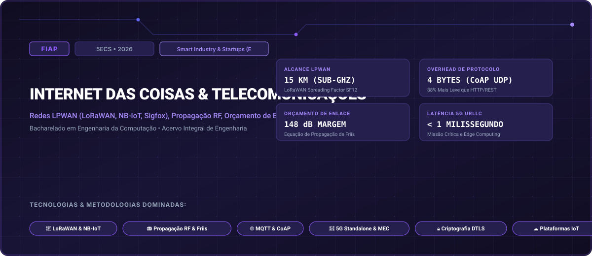

# FIAP • Internet das Coisas & Telecomunicações (2026)

> **Engenharia da Computação — FIAP (Faculdade de Informática e Administração Paulista)**  
> **Turma:** 5ECS • Ano Letivo 2026  
> **Desafio Corporativo Integrado:** Smart Industry & Startups (Exoesqueleto Assistivo & Manufatura)  
> **Portal Interativo GitHub Pages:** [https://guimemee.github.io/fiap-iot-and-telecom/](https://guimemee.github.io/fiap-iot-and-telecom/)

---

## 📋 Sumário Executivo do Acervo

Este repositório consolida o acervo acadêmico integral e os projetos práticos de engenharia da disciplina **Internet das Coisas & Telecomunicações**, contemplando:
1. **6 Checkpoints Oficiais (2026):** Enunciados integrais originais, memórias de cálculo passo a passo no padrão Symbolab e cadernos Jupyter (`.ipynb`) com gráficos executáveis.
2. **01_Apostilas_e_Teoria:** Livros didáticos, apostilas e slides de aulas.
3. **02_Exercicios_e_Laboratorios:** Listas práticas, scripts e códigos de laboratório.
4. **04_Global_Solution:** Desafios integradores semestrais da FIAP.
5. **05_Challenge_Sprints:** Sprints interdisciplinares de inovação corporativa (Smart Industry & Startups (Exoesqueleto Assistivo & Manufatura)).

---

## 🎯 6 Checkpoints Oficiais (2026)

- **Checkpoint 1:** Arquiteturas de Telecomunicações e Tecnologias de Redes LPWAN &rarr; [`03_Provas_Avaliativas_Checkpoints/Checkpoint_1_cp1/Resolucao_Calculos.ipynb`](03_Provas_Avaliativas_Checkpoints/Checkpoint_1_cp1/Resolucao_Calculos.ipynb)
- **Checkpoint 2:** Protocolos Leves de Transporte de Mensagens: MQTT vs. CoAP &rarr; [`03_Provas_Avaliativas_Checkpoints/Checkpoint_2_cp2/Resolucao_Calculos.ipynb`](03_Provas_Avaliativas_Checkpoints/Checkpoint_2_cp2/Resolucao_Calculos.ipynb)
- **Checkpoint 3:** Propagação Eletromagnética, Antenas e Orçamento de Enlace (Link Budget) &rarr; [`03_Provas_Avaliativas_Checkpoints/Checkpoint_3_cp3/Resolucao_Calculos.ipynb`](03_Provas_Avaliativas_Checkpoints/Checkpoint_3_cp3/Resolucao_Calculos.ipynb)
- **Checkpoint 4:** Plataformas IoT em Nuvem, Ingestão Massiva e Séries Temporais &rarr; [`03_Provas_Avaliativas_Checkpoints/Checkpoint_4_cp4/Resolucao_Calculos.ipynb`](03_Provas_Avaliativas_Checkpoints/Checkpoint_4_cp4/Resolucao_Calculos.ipynb)
- **Checkpoint 5:** Criptografia e Segurança em Redes IoT: TLS 1.3 e DTLS em Hardware &rarr; [`03_Provas_Avaliativas_Checkpoints/Checkpoint_5_cp5/Resolucao_Calculos.ipynb`](03_Provas_Avaliativas_Checkpoints/Checkpoint_5_cp5/Resolucao_Calculos.ipynb)
- **Checkpoint 6:** Redes Móveis 5G, Arquitetura Standalone (SA) e Fatiamento de Rede &rarr; [`03_Provas_Avaliativas_Checkpoints/Checkpoint_6_cp6/Resolucao_Calculos.ipynb`](03_Provas_Avaliativas_Checkpoints/Checkpoint_6_cp6/Resolucao_Calculos.ipynb)

---

## 🏛️ Créditos e Rastreabilidade
- **Instituição:** FIAP (Faculdade de Informática e Administração Paulista)
- **Curso:** Bacharelado em Engenharia da Computação
- **Turma:** 5ECS • Ano Letivo 2026
- **Aluno:** Guilherme Macário da Silva ([@Guimemee](https://github.com/Guimemee))
